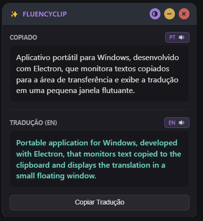

# FluencyClip

Aplicativo portátil para Windows, desenvolvido com Electron, que monitora textos copiados para a área de transferência e exibe a tradução em uma pequena janela flutuante.

## Prévia do aplicativo



## Como funciona

1. O aplicativo verifica a área de transferência a cada segundo.
2. Quando encontra um texto novo, envia o conteúdo ao serviço de tradução do Google com detecção automática do idioma.
3. Textos detectados como inglês são traduzidos para português.
4. Textos detectados em outros idiomas são traduzidos para inglês.
5. A janela mostra o texto original, os idiomas de origem e destino e a tradução.

Também é possível:

- ouvir o texto original ou traduzido usando a síntese de voz do Windows;
- copiar a tradução para a área de transferência;
- mover, minimizar ou fechar a janela;
- alterar manualmente a largura arrastando uma das bordas laterais;
- remover ou restaurar a transparência da janela pelo botão da interface;
- redimensionar automaticamente a janela conforme o conteúdo, até o limite definido pela interface.

## Requisitos

### Para usar o executável

- Windows 10 ou 11 de 64 bits;
- conexão com a internet;
- acesso ao serviço `translate.googleapis.com`.

O executável é portátil: não requer instalação. Basta abri-lo para iniciar o monitoramento da área de transferência.

### Para desenvolvimento

- Node.js 18 ou superior;
- npm.

## Executar em modo de desenvolvimento

```bash
npm install
npm start
```

Depois de abrir o aplicativo, copie um texto em qualquer programa. A tradução será atualizada automaticamente na janela do FluencyClip.

## Gerar o executável portátil

```bash
npm install
npm run build
```

O arquivo portátil será criado na pasta `dist`. A configuração do projeto gera somente o alvo `portable` para Windows; não é criado instalador.

## Estrutura principal

- `src/main/main.js`: cria a janela, monitora a área de transferência e coordena a tradução.
- `src/main/preload.js`: expõe ao renderer apenas as operações IPC utilizadas pela interface.
- `src/services/googleTranslator.js`: detecta o idioma e realiza as chamadas de tradução.
- `src/renderer/overlay.html`: contém a estrutura da interface.
- `src/renderer/overlay.css`: concentra todos os estilos visuais e animações.
- `src/renderer/overlay.js`: controla as interações, atualizações da tradução e síntese de voz.
- `assets/icon.png`: ícone utilizado pela janela do aplicativo.
- `assets/tela_aplicativo.png`: imagem de apresentação utilizada no README.
- `package.json`: define dependências, comandos e empacotamento portátil.

## Privacidade e limitações

- Todo novo texto copiado enquanto o aplicativo está aberto pode ser enviado ao serviço de tradução do Google. Evite copiar senhas, tokens, dados bancários ou informações confidenciais durante o uso.
- A integração usa um endpoint web público do Google Translate (`client=gtx`), e não a API oficial Google Cloud Translation. Ela não exige chave, mas não oferece garantia de disponibilidade e pode mudar ou limitar requisições sem aviso.
- O aplicativo não mantém histórico nem grava os textos traduzidos em arquivo.
- A detecção automática e a qualidade da tradução dependem da resposta do serviço externo.
- Ao copiar a tradução pelo botão da interface, esse novo conteúdo passa a ser o texto mais recente da área de transferência e pode gerar outra tradução automática.

## Tecnologias

- Electron
- electron-builder
- Google Translate (endpoint web público)
- Web Speech API

## Licença

O projeto ainda não possui uma licença definida. Adicione um arquivo `LICENSE` antes de distribuir publicamente caso queira estabelecer regras de uso, modificação e redistribuição.
